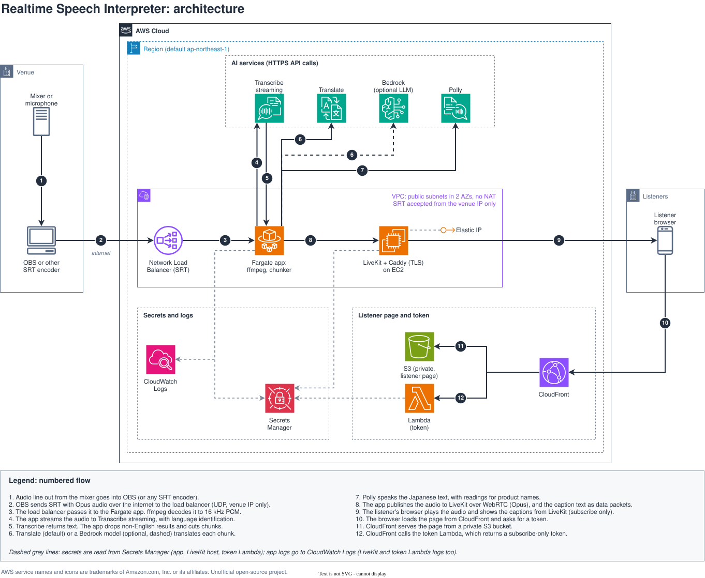

# Realtime Speech Interpreter

Real-time speech-to-speech interpretation on AWS, English to Japanese first. A speaker talks English at an event.
Attendees open a web page on their phones and hear Japanese about 6 seconds later. The audio goes from OBS over SRT
to an app on AWS Fargate. The app uses Amazon Transcribe to get text, Amazon Translate or an Amazon Bedrock model
to translate it, and Amazon Polly to speak it. A self-hosted LiveKit server delivers the audio to the browsers.

This is a personal, unofficial open-source project. It is not an AWS product, it is not affiliated with, endorsed or
supported by Amazon Web Services, and AWS Support will not help with it. AWS, Amazon Transcribe, Amazon Translate,
Amazon Polly, Amazon Bedrock and AWS Fargate are trademarks of Amazon.com, Inc. or its affiliates.



Details of the diagram: [docs/architecture.md](docs/architecture.md).

## What works today

| Use case | Status | Notes |
|---|---|---|
| One speaker, English to Japanese (talk, keynote) | **Supported** | The case this project was built and tested for. |
| Japanese speech in the room is ignored | **Supported** | A language filter drops it, so a moderator or a question is not translated. |
| Custom dictionaries and pronunciations | **Supported** | Edit files, run a script. See [docs/dictionaries.md](docs/dictionaries.md). |
| Round table or fireside chat, several speakers | **Planned** | Needs speaker detection and a different voice per speaker. |
| Q&A in two directions with two channels | **Planned** | Channel 1: English to Japanese. Channel 2: Japanese to English, from the same audio. |
| Captions on the listener page | **Supported** | After **Listen** is pressed, Japanese captions appear below the button in time with the voice, and the English source as it is recognised; Japanese speech is shown as said with a `―` marker. See below. |
| Browser microphone as input (`getUserMedia`) | **Optional** (`-c inputSource=browser`), live tests pending | For venues with no audio line out, or no PC to run OBS. See [security.md](docs/security.md#browser-microphone-input). |
| RTMPS as input (OBS over TCP 443) | **Optional** (`-c inputSource=rtmps`), live tests pending | For venues whose network blocks outbound UDP. See [alternative-inputs.md](docs/alternative-inputs.md). |
| Dictionary builder (easier than editing files) | **Idea** | A tool that suggests terms from slides or a transcript. |
| Voice that follows the speaker | **Idea** | Depends on speaker detection. |

## Input options

SRT is the default, but not the only way to get the speaker's audio in. Pick one per deploy with `-c inputSource=...`;
exactly one input runs at a time.

| Input | Setting | When to use it |
|---|---|---|
| SRT from OBS or ffmpeg | `srt` (default) | A PC at the venue gets the room audio (audio line out) and the venue network lets UDP out. Lowest setup risk, tested most. |
| Browser microphone | `browser` | The venue gives no audio line output, or OBS and ffmpeg cannot be used: no extra PC is allowed and only the speaker's own laptop is at the lectern. The speaker opens a page and types an event code. |
| RTMPS from OBS or ffmpeg | `rtmps` | The venue network forbids outbound UDP, so SRT cannot reach AWS. OBS still runs at the venue and streams over TCP 443, which venues usually allow. |

The architecture diagram above shows the SRT path. How the browser and RTMPS paths work, and why:
[docs/alternative-inputs.md](docs/alternative-inputs.md).

## Quick start (about 10 minutes plus deploy time)

You need an AWS account where you may create VPCs, ECS, EC2, CloudFront, Lambda, S3 and IAM resources. Running the
stack costs money, see [Costs](#costs).

**Prerequisites**

| Tool | Version | Check |
|---|---|---|
| Git | any | `git --version` |
| Node.js and npm | Node 20 or newer (22 recommended), npm 9 or newer | `node --version` |
| AWS CLI | v2 | `aws --version` |
| Docker | running daemon (builds the app image) | `docker info` |
| ffmpeg with SRT and Opus | for the encoder test and the e2e harness | `ffmpeg -protocols 2>/dev/null \| grep srt` |

On macOS, `brew install ffmpeg-full` includes SRT. The plain `ffmpeg` formula does not.
Use AWS credentials for the target account (`aws sts get-caller-identity` must work).

**1. Clone and install**

```bash
git clone https://github.com/kuu/realtime-speech-interpreter.git
cd realtime-speech-interpreter
(cd app && npm ci)
(cd cdk && npm ci)
```

**2. Describe your event**

```bash
cp cdk/config/event.example.json cdk/config/event.json
```

Edit `cdk/config/event.json`. At least set `venueCidr` to the public IP address of the venue network (find it from
the venue network with `curl https://checkip.amazonaws.com`, then add `/32`). Every setting is explained in
[docs/configuration.md](docs/configuration.md). `event.json` is git-ignored.

**3. Check your machine and account** (read-only)

```bash
./scripts/doctor.sh
```

Fix every `FAIL` line. Each one prints the command that fixes it.

**4. Bootstrap CDK** (once per account and Region)

```bash
cd cdk && npx cdk bootstrap && cd ..
```

**5. Publish the dictionaries**

```bash
node dictionaries/validate.mjs
(cd cdk && ./scripts/dictionaries.sh)
```

This creates a Transcribe custom vocabulary and a Translate terminology named `simul-translation`, from the example
dictionary in `dictionaries/example/` (AWS Elemental Media Services terms). Step 9 replaces it with your own.

**6. Deploy**

```bash
cd cdk && npx cdk deploy && cd ..
```

It builds the app image and takes several minutes. The outputs include `ListenerUrl` and the SRT address.
Without Bedrock access, set `"translateEngine": "translate"` in `event.json` first.

**7. Test with a sample, without OBS**

```bash
./samples/make-samples.sh talk-single      # makes samples/out/talk-single.wav with Polly (a few cents)
./e2e/e2e.sh check
./e2e/e2e.sh local samples/out/talk-single.wav --duration 1m --label first-try
```

`check` must say `READY`. `local` runs the app on your machine against a short English clip and writes the Japanese
audio to `e2e/runs/`. Open the folder and play `side-by-side.wav` (left: English, right: Japanese).
See [docs/e2e-testing.md](docs/e2e-testing.md).

**8. Send audio by SRT and listen**

Get the SRT URL and passphrase from the stack outputs (commands in [docs/operations.md](docs/operations.md)), then
send a file with ffmpeg, or point OBS at the same URL:

```bash
ffmpeg -re -i path/to/english-speech.wav -vn -ac 1 -ar 48000 -c:a libopus -b:a 128k -f mpegts \
  "srt://<SrtIngestIp1>:9000?mode=caller&latency=120000&pbkeylen=16&passphrase=<SRT_PASSPHRASE>"
```

Open the `ListenerUrl` on a phone, press **Listen**, and put on headphones. Run this command from the network that
you put in `venueCidr`.

After **Listen** is pressed, captions appear below the button: the Japanese line when its audio starts, and the English
source line as it is recognised. Listeners without earphones can mute the phone and read. `ListenerUrl?source=off`
hides the English line (no visible switch). `-c captions=off` at deploy time turns both lines off and keeps the page
as it was. Japanese speech (for example audience questions) is shown as said, untranslated, on lines that start
with `―`, one whole sentence at a time; it is never translated or spoken (`-c captionsJapaneseSpeech=off` turns only that off).

**9. Make your own dictionary**

The example dictionary fits AWS media talks. For your subject, build your own. It lives in `dictionaries/local/`, which
git ignores, so it cannot be committed by mistake.

```bash
node dictionaries/build.mjs init                          # copy the example to dictionaries/local/
node dictionaries/build.mjs suggest --from notes.md       # candidate terms from your slides or notes (.txt, .md, .pdf)
# edit dictionaries/local/terms.proposed.csv, then:
node dictionaries/build.mjs merge && node dictionaries/build.mjs generate
(cd cdk && ./scripts/dictionaries.sh --dry-run && ./scripts/dictionaries.sh --restart-app)
```

The Polly readings travel in the app image, so run `npx cdk deploy` when they changed. The whole workflow, the
`terms.csv` format and the optional Bedrock suggestions are in [docs/dictionaries.md](docs/dictionaries.md).

## Costs

Prices as of 2026-11-15, region ap-northeast-1, USD, list price, tax excluded.

| Case | Cost |
|---|---|
| Running session, 100 listeners, LLM engine (default `talk` profile) | about **$2.4 per hour** |
| Same with the Amazon Translate engine | about $2.0 per hour |
| Stack left deployed with nobody speaking | about **$4.9 per day** (about $0.20 per hour) |
| ECS desired count 0 / also LiveKit instance stopped | about $3.6 / $1.0 per day |
| After `cdk destroy` | about $0.003 per day |

The speech services (Transcribe, Bedrock or Translate, Polly) are 75-80% of a running hour. The Network Load Balancer,
the EC2 host, the Fargate task and the Elastic IPs bill whether or not anyone is listening. Set the ECS desired count
to 0, stop the LiveKit instance, or run `cdk destroy` when you are done. The figures are estimates from one measured
cloud run and list prices. See [docs/cost.md](docs/cost.md) for every billed resource, what is measured and what is
assumed, the listener-count sensitivity and the calculator (`node scripts/estimate-cost.mjs --hours 4 --listeners 100`).

## Customize

| What | How | Needs |
|---|---|---|
| Terms the speech recognizer gets wrong | Add a row to `terms.csv` in your dictionary folder (`transcribe_en`), run `generate`. | `dictionaries.sh` |
| Translation of a term | Add a row with `ja` and `translate_en_ja` to `terms.csv`, run `generate`. | `dictionaries.sh` |
| Polly pronunciation of a name | Add a row with `reading` and `polly_ja` to `terms.csv`, run `generate`. The displayed text never changes. | `cdk deploy` |
| Wrong word that is valid English (ABC for AVC) | Add a rule in `app/src/corrections.ts`. | `cdk deploy` |
| Voice | `"pollyVoice"` in `event.json`. | `cdk deploy` |
| Speed of the first word vs. quality | `"profile"` in `event.json`: `talk` (fast, LLM), `careful` (longer chunks, Translate). | `cdk deploy` |
| Translation engine and model | `"translateEngine"` and `"llmModelId"` in `event.json`. | `cdk deploy` |
| Expected number of listeners | `"expectedListeners"`. Sets the LiveKit instance size (an estimate). | `cdk deploy` |

Your dictionary folder is `dictionaries/local/` (see step 9). Edit `terms.csv`, then run
`node dictionaries/build.mjs generate`, which also validates. Never edit the three generated files by hand. See [docs/dictionaries.md](docs/dictionaries.md) and
[docs/configuration.md](docs/configuration.md).

## Event-day checklist

- [ ] Venue public IP is in `venueCidr` and deployed. Test it from the venue network.
- [ ] `./e2e/e2e.sh check` says `READY`.
- [ ] Dictionaries are published and match the talk.
- [ ] SRT URL and passphrase are on the encoder machine (not in chat).
- [ ] Rehearsal done with the real encoder and network. You heard Japanese on a phone.
- [ ] Only one encoder is connected.
- [ ] The listener URL is on the slides or a QR code, with the machine-translation notice.
- [ ] Someone watches the logs. Log lines to look for are in [docs/operations.md](docs/operations.md).
- [ ] After the event: scale down or `cdk destroy`.

## Troubleshooting

| Symptom | Cause and fix |
|---|---|
| OBS or ffmpeg keeps "connecting" and nothing is logged | **The venue IP is not allowed.** SRT is UDP, so a blocked sender gets no error. Check the public IP from the venue network, put it in `venueCidr`, run `cdk deploy`. `./e2e/e2e.sh check` tells you whether this machine is allowed. A phone hotspot has another IP. |
| Second encoder cannot connect | **Only one SRT sender at a time.** Stop the first one (a test encoder, a second OBS). |
| Connected, but listeners hear nothing | Tap **Listen** again (browsers need a tap). Run `./e2e/e2e.sh check`. Look in `/simul-translation/app` for `[livekit] connected` and `PLAYED`. Check that the speech really is English: Japanese speech is dropped on purpose. |
| Polly says a product name wrongly | Add a reading row to `terms.csv` (`reading`, `polly_ja=y`), `node dictionaries/build.mjs generate`, `cdk deploy`. Do not change the name in the text. See [docs/dictionaries.md](docs/dictionaries.md). |
| A term is heard as another word | Add it to the vocabulary. If it is still wrong (for example ABC for AVC), add a context correction. |
| Bedrock "access denied" or "model not found" | Open the Bedrock console in your Region and check that the model in `llmModelId` is available to your account (first use of some models asks for a use-case form). `./scripts/doctor.sh` checks the profile. Or use `"translateEngine": "translate"`. |
| `doctor` says CDK is not bootstrapped | Run step 4. |
| Page loads, status says not connected | The LiveKit instance is stopped or still starting. `./e2e/e2e.sh check --fix`. |

## Security and privacy

- The listener page and the token endpoint are public. Tokens only allow listening, and expire after 6 hours.
- SRT is accepted from your venue IP only, and needs a passphrase. RTMPS (optional) is accepted from your venue IP
  only (checked by Caddy) and needs a stream key.
- Secrets are in AWS Secrets Manager. IAM roles are limited to the calls the app makes.
- Audio is not recorded. The text of every chunk is written to CloudWatch Logs (14 days by default).
- Speech and text go to Amazon Transcribe, Translate or Bedrock, and Polly. Tell speakers and attendees.
- The translation is machine-made. Show a notice on the listener page.

Details and a suggested notice: [docs/security.md](docs/security.md). Report vulnerabilities as described in
[SECURITY.md](SECURITY.md).

## Documentation

| Page | Content |
|---|---|
| [docs/architecture.md](docs/architecture.md) | Components, data flow, latency budget, design choices |
| [docs/alternative-inputs.md](docs/alternative-inputs.md) | Browser microphone and RTMPS inputs: when to use them, how they work |
| [docs/bilingual-channels.md](docs/bilingual-channels.md) | Design (planned, not built): second channel, Japanese to English |
| [docs/configuration.md](docs/configuration.md) | All settings |
| [docs/dictionaries.md](docs/dictionaries.md) | Vocabulary, terminology, readings, corrections |
| [docs/operations.md](docs/operations.md) | Event-day runbook, monitoring, tear down |
| [docs/security.md](docs/security.md) | Exposure, secrets, IAM, privacy, consent |
| [docs/cost.md](docs/cost.md) | Billed resources, cost per hour, idle cost, how to stop paying |
| [docs/e2e-testing.md](docs/e2e-testing.md) | Test harness and metrics |

## Roadmap

Planned work and ideas are tracked in [GitHub Issues](https://github.com/kuu/realtime-speech-interpreter/issues).

## Contributing

Issues and pull requests are welcome; see [CONTRIBUTING.md](CONTRIBUTING.md). Before you open a pull request:

```bash
(cd app && npm run build && npm run typecheck && npm test)
(cd cdk && npm test)
node dictionaries/validate.mjs dictionaries/example
node dictionaries/build.mjs generate --check --dir dictionaries/example
node --test "dictionaries/test/*.test.mjs"
node scripts/check-diagram.mjs
./scripts/check-publishable.sh
```

If you change the diagram, edit `docs/architecture.drawio.svg` in draw.io and run `scripts/export-diagram.sh` (see [docs/architecture.md](docs/architecture.md)).
Do not commit account IDs, IP addresses, secrets or recordings.

## License

MIT. See [LICENSE](LICENSE). Third-party notices: [THIRD_PARTY_NOTICES.md](THIRD_PARTY_NOTICES.md).
Maintainer: Kuu Miyazaki.
