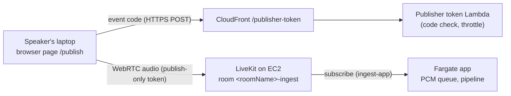
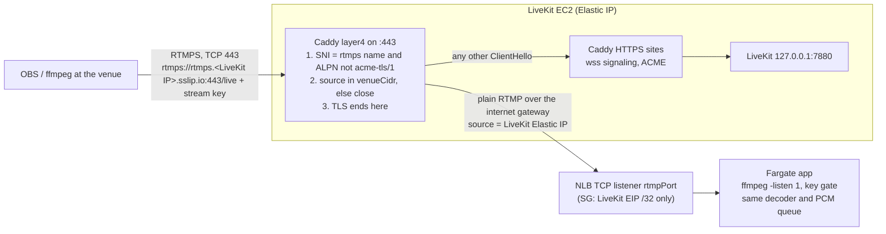

# Alternative inputs: browser microphone and RTMPS

SRT from OBS or ffmpeg is the default input and the one in the [architecture diagram](architecture.drawio.svg). Two
other inputs exist for venues where SRT does not work. Exactly one input runs per deploy (`inputSource`), never two.
Everything after the app's PCM queue (Transcribe, translation, Polly, LiveKit, captions) is the same for all three.

| Input | Setting | Use it when | Status |
|---|---|---|---|
| SRT (default) | `inputSource=srt` | A PC at the venue runs OBS or ffmpeg with the room audio, and the venue network lets UDP out. | Supported |
| Browser microphone | `inputSource=browser` | The venue gives no audio line out, or OBS and ffmpeg cannot be used (no extra PC allowed, the speaker's own laptop only). | Optional, live tests pending ([#10](https://github.com/kuu/realtime-speech-interpreter/issues/10)) |
| RTMPS | `inputSource=rtmps` | The venue network forbids outbound UDP, so SRT cannot reach AWS. OBS or ffmpeg still runs at the venue and sends over TCP 443. | Optional, live tests pending ([#11](https://github.com/kuu/realtime-speech-interpreter/issues/11)) |

Switching input is one `cdk deploy` with another `-c inputSource=...`.

## Browser microphone path

The speaker opens `/publish` on their own laptop, types the shared event code and the page publishes the microphone
into a separate ingest room on the existing LiveKit server. The app subscribes to that room and pushes the frames into
the same PCM queue the SRT path uses. The venue IP allowlist does not apply to this input: the event code is the gate.
Design, threat model and tests: [security.md](security.md#browser-microphone-input). Operation:
[operations.md](operations.md#browser-microphone-input-only-with--c-inputsourcebrowser).

## RTMPS path

1. The encoder connects to `rtmps://rtmps.<LiveKit IP>.sslip.io:443/live` with the stream key from Secrets Manager.
   TCP 443 to the LiveKit host is already open to the internet for wss signaling, so a venue that blocks UDP usually
   still lets this through.
2. Caddy on the LiveKit host runs the [caddy-l4](https://github.com/mholt/caddy-l4) listener wrapper on :443. It reads
   the TLS ClientHello before Caddy's HTTPS stack. A connection is taken by the RTMPS route only when its SNI is the
   RTMPS name **and** its ALPN is not `acme-tls/1`. Everything else (the wss name `<LiveKit IP>.sslip.io`, any ACME
   challenge, any other name) falls through to the HTTPS sites exactly as before.
3. Inside the route, a source address outside `venueCidr` is closed before the TLS handshake. An allowed source gets
   TLS with the certificate of the RTMPS name, and the decrypted RTMP stream is proxied to the NLB.
4. Caddy connects to the NLB's first Elastic IP on `rtmpPort` (default 1935). The connection leaves the instance through
   the internet gateway, so the NLB sees the LiveKit Elastic IP as the source. The NLB security group allows that port
   from `<LiveKit Elastic IP>/32` only.
5. The NLB forwards to the Fargate task. The app runs `ffmpeg -listen 1 -i rtmp://0.0.0.0:<rtmpPort>/live/<key>` with
   the same decode arguments and the same `-analyzeduration` (`RTMP_ANALYZE_MS`, 500 ms) as SRT, and pushes the PCM
   into the same queue. A new listener starts after every disconnect, as for SRT.

### Why it is built this way

- **One public port.** RTMPS shares :443 with wss signaling. Venues that forbid UDP almost always allow TCP 443, and no
  new public port or hostname is needed.
- **Routing needs the name (SNI).** Caddy decides between RTMPS and wss by the TLS server name. A URL with a bare IP
  (`rtmps://<IP>:443/...`) sends no usable name, lands on the HTTPS stack and fails. Copy the `RtmpsUrl` stack output
  as it is. The `rtmps.` name exists only for the `sslip.io` host, so `inputSource=rtmps` requires an empty
  `livekitHostname`.
- **The ACME challenge is excluded.** Caddy gets certificates with TLS-ALPN-01 on :443 (port 80 stays closed). Let's
  Encrypt validates from its own addresses, which are not in `venueCidr`. Without the `not tls alpn acme-tls/1` line
  the route would close those connections and issuance and renewal for the RTMPS name would fail. Both names keep
  `disable_http_challenge`. The `rtmps.` site block in the Caddyfile only makes Caddy obtain and renew that
  certificate; an HTTPS request to that name is taken by the RTMPS route, not answered as a web page.
- **The venue check moves into Caddy.** For SRT the security groups hold the venue allowlist. For RTMPS the port is
  :443, open to everyone for wss, so the allowlist is Caddy's `remote_ip` matcher. See
  [security.md](security.md#rtmps-input).
- **The NLB rule names the Elastic IP, not the LiveKit security group.** Caddy reaches the NLB through its public
  address, so the packets arrive from the Elastic IP. A rule that references the LiveKit security group would never
  match. The RTMP target group sets `preserve_client_ip.enabled=false`, so the task sees the NLB as the source and
  `AppSg` admits the port from the NLB security group only.
- **No second load balancer.** The existing internet-facing NLB gets one TCP listener. An internal NLB would add a
  resource and an hourly charge for one connection.
- **A custom Caddy image, only for this input.** Layer4 routing needs the caddy-l4 plugin, which the official image
  does not contain. `cdk/caddy-l4/Dockerfile` builds Caddy with it from pinned versions and digests. CDK builds it as an
  image asset and stores it in the CDK assets ECR repository; the LiveKit instance role may pull that repository only.
  With `srt` or `browser` the instance keeps the official `caddyImage` and today's Caddyfile, byte for byte.
- **`caddy validate` before start.** The boot script validates the generated Caddyfile with the custom image before
  starting Caddy. A config Caddy rejects stops the boot (`set -e`) instead of taking wss signaling down.

### Stream key check

The key is the last path element of the URL the app's ffmpeg listens on. ffmpeg does **not** refuse a publisher with
another key or app name: it logs `Unexpected stream <name>, expecting <key>` or `App field don't match up` and then
decodes the stream anyway (checked with ffmpeg 9.0.2 and with the app image's ffmpeg 5.1.9). So the app gates the PCM:

- All PCM of a connection is held until ffmpeg's log shows the input was opened (`Input #0`) with no mismatch line
  before it. Then the held PCM goes into the queue and the rest passes through directly.
- A mismatch line kills ffmpeg, drops the held PCM and logs `[rtmp] rejected publish with a wrong key`. The key and the
  received name are never logged. A new listener starts.
- If PCM arrives and the gate has not opened within 2 seconds, the connection is rejected the same way (fail closed).
- The app refuses to start with an empty key or a key that is not 16 to 128 letters and digits.

The check depends on these ffmpeg log lines. `app/test/rtmp-ffmpeg-image.test.ts` runs the ffmpeg of a built app image
and fails if a wrong key or app name stops printing them; run it after every change of the app image's ffmpeg
(`RTMP_IMAGE=<tag> npm test`, see the test file). The unit tests prove the gate with a fake ffmpeg that writes PCM
before its log lines.

### Latency

Low latency comes first, so nothing in this path adds a buffer:

- The app uses the SRT decode arguments plus `-listen 1`. No `-fflags nobuffer` or other extra flags were added: the
  path through Caddy is already within about 5 ms of direct RTMP (below), so there was no gap for them to close.
- The key gate holds PCM only until ffmpeg prints the opened input. Measured hold on a correct publish: **0 ms** (the
  line comes before the first PCM).
- Local loopback measurement (a click every second, AAC encode and decode included, Caddy in Docker, no internet):
  through Caddy and the key gate median 107 ms, direct RTMP to the app median 102 ms. The probe measured the same
  setup with ffmpeg alone: RTMPS through Caddy 104 to 109 ms, direct RTMP 103 to 105 ms, SRT with
  `srtLatencyMs=120` and MPEG-TS 523 to 524 ms. TLS and Caddy add about 5 ms. On a real network, TCP retransmission can
  add delay under packet loss where SRT would not; compare it against SRT in the live test.

### Limits

- One Caddy process carries both wss signaling and RTMPS ingest. A Caddy crash stops both. `caddy validate` and the
  off-by-default route limit that risk.
- Changing `venueCidr` with `inputSource=rtmps` changes the LiveKit boot script, so the LiveKit instance is replaced
  (a short outage; the Elastic IP stays). The same happens when switching `inputSource` to or from `rtmps`.
- Plain RTMP between Caddy and the NLB crosses the internet gateway inside AWS, unencrypted. The NLB port admits only
  the LiveKit Elastic IP. See [security.md](security.md#rtmps-input).
- Not verified yet (live tests): hardware encoders and their SNI behavior, the NLB path from the instance's Elastic IP,
  certificate issuance and renewal from Let's Encrypt for the `rtmps.` name (only a local ACME server was used), and
  Let's Encrypt rate limits for frequent redeploys.
- You own the custom image: rebuild it when Caddy, caddy-l4 or Go publish a security release
  ([cdk/caddy-l4/README.md](../cdk/caddy-l4/README.md)).

Operation (deploy flag, URL, stream key, OBS settings): [operations.md](operations.md#rtmps-input-only-with--c-inputsourcertmps).
