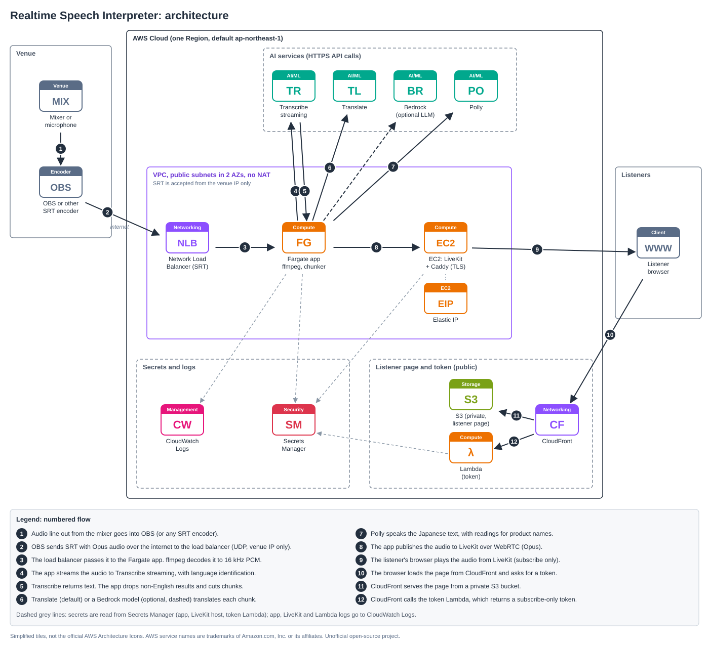
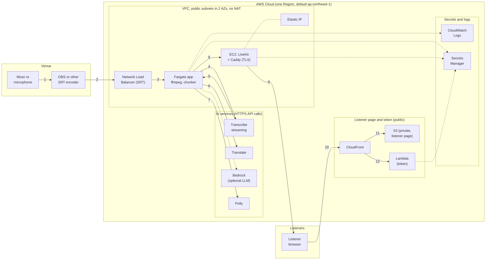

# Architecture



The picture is generated from [`architecture.model.json`](architecture.model.json). The tiles are simplified
drawings, not the official AWS Architecture Icons. The editable file [`architecture.drawio`](architecture.drawio)
uses draw.io's built-in AWS shapes.

## Components

| Component | AWS service or software | What it does | Defined in |
|---|---|---|---|
| Venue encoder | OBS or any SRT encoder | Sends the venue audio as SRT with Opus. | outside the stack |
| SRT entry | Network Load Balancer (UDP 9000) with static Elastic IPs, security groups | Accepts SRT from the venue IP only. | `cdk/lib/simul-translation-stack.ts` |
| App | ECS on Fargate (1 task, ARM64) | Decodes audio, calls the AI services, publishes audio to LiveKit. | `app/src/`, `cdk/lib/` |
| Speech to text | Amazon Transcribe streaming | Text with partial results and per-result language. | `app/src/pipeline.ts` |
| Translation | Amazon Translate, or Amazon Bedrock (optional) | English to Japanese per chunk. | `app/src/translate-engine.ts`, `app/src/bedrock-llm.ts` |
| Text to speech | Amazon Polly | Japanese speech. Readings for product names. | `app/src/chunk-player.ts`, `app/src/polly-readings.ts` |
| Media server | LiveKit (container) and Caddy (TLS) on one EC2 instance with an Elastic IP | Delivers the audio to browsers over WebRTC. | `cdk/lib/livekit-user-data.ts` |
| Listener page | CloudFront, private S3 bucket | Static page with the LiveKit client. | `app/web/` |
| Token endpoint | Lambda function URL behind CloudFront (`/token`) | Issues subscribe-only LiveKit tokens. | `cdk/lambda/token/` |
| Secrets | Secrets Manager | LiveKit API key and secret, SRT passphrase. | stack |
| Logs | CloudWatch Logs | `/simul-translation/app`, `/livekit`, `/token`. | stack |

## Data flow

The numbers match the diagram.

<!-- BEGIN STEPS (generated by scripts/render-architecture.mjs, do not edit) -->
| Step | What happens |
|---|---|
| 1 | Audio line out from the mixer goes into OBS (or any SRT encoder). |
| 2 | OBS sends SRT with Opus audio over the internet to the load balancer (UDP, venue IP only). |
| 3 | The load balancer passes it to the Fargate app. ffmpeg decodes it to 16 kHz PCM. |
| 4 | The app streams the audio to Transcribe streaming, with language identification. |
| 5 | Transcribe returns text. The app drops non-English results and cuts chunks. |
| 6 | Translate (default) or a Bedrock model (optional, dashed) translates each chunk. |
| 7 | Polly speaks the Japanese text, with readings for product names. |
| 8 | The app publishes the audio to LiveKit over WebRTC (Opus). |
| 9 | The listener's browser plays the audio from LiveKit (subscribe only). |
| 10 | The browser loads the page from CloudFront and asks for a token. |
| 11 | CloudFront serves the page from a private S3 bucket. |
| 12 | CloudFront calls the token Lambda, which returns a subscribe-only token. |
<!-- END STEPS -->

Inside the app (steps 3 to 8), each stage is a small module:

1. `srt-source.ts` runs ffmpeg as the SRT listener and writes 16 kHz mono PCM. The first PCM arrives within
   about a second (`SRT_ANALYZE_MS`).
2. `pipeline.ts` sends 100 ms frames to Transcribe streaming with language identification between `en-US` and
   `ja-JP`.
3. `language-gate.ts` forwards only results identified as the source language. Japanese speech (a moderator, a
   question from the room) is dropped.
4. `segmenter.ts` turns partial results into chunks of a few words (see "Design choices").
5. `translate-engine.ts` translates each chunk. With the LLM engine a failed or slow call falls back to Translate.
6. `chunk-player.ts` asks Polly for speech, picks a speed level, and writes the audio to LiveKit in order.
7. If the listener falls too far behind, chunks are dropped (`MAX_BACKLOG_MS`) instead of piling up.

## Latency budget

Measured for the start of a sentence with the `talk` profile (fast timing, LLM engine). `e2eFirstWordMs` is
the time from the speaker saying the first word of a chunk to the listener hearing its first translated word.

| Stage | Typical time | Note |
|---|---|---|
| Speaker says the chunk | about 3.2 s | The chunk must be spoken before it can be cut. Shorter chunks lower this. |
| Transcribe waits for stable words | about 2.0 s | Partial-result stabilization (`PARTIAL_STABILITY=high`). |
| Translation (LLM) | about 0.5 s | Amazon Translate is about 0.6 s per chunk faster in this setup but scored lower. |
| Polly | about 0.16 s | One request per chunk. |
| Queue and network | about 0.2 s | Waiting for the previous chunk to finish playing, then WebRTC. |
| **Total, first word** | **about 6 s** | Typical `e2eFirstWordMs` with the `talk` profile. |

The numbers come from the project's own test runs. They depend on the speaker's pace and the venue network.
`./e2e/e2e.sh` measures them for your material, see [e2e-testing.md](e2e-testing.md).

## Design choices

**LiveKit, not Amazon IVS.** IVS Real-Time accepts WHIP publishing, but it requires an H.264 video track, even
for audio only. LiveKit publishes audio-only from a server SDK and plays it in the browser. It is open source
(Apache-2.0) and runs on one EC2 instance. The Chime SDK has no clean path to publish audio from a headless server.

**OBS and SRT for ingest.** Event teams already know OBS. SRT survives packet loss on venue networks and
supports a passphrase. The Network Load Balancer gives static IPs, so the venue can allow-list them.

**Language filter.** Rooms with a moderator or questions in Japanese would otherwise be transcribed as English-looking
words and translated into nonsense. Transcribe identifies the language of every result and the app drops results that
are not the source language. Short low-confidence English fragments inside Japanese speech are dropped too.
`LANGUAGE_FILTER=off` restores the old behavior.

**Chunking with merge and dangling rules.** The segmenter cuts at sentence ends, at clauses once a chunk has
enough words, and on pauses. Two rules keep chunks translatable:

- *Merge:* a very short sentence ("OK.", "I see.") is held and joined with the next one. Complete sentences are never held.
- *Dangling:* a chunk that would end on a preposition, article or "that" waits a short time for the next words.

Both rules have a time limit, so they cannot stall the speech.

**Speed levels.** Japanese speech is usually slower than English. When the backlog grows, Polly speaks faster, in
graded levels (100, 110, 120, 130, 145 percent by default) with a hold time and hysteresis. Small steady changes
sound calmer than large jumps. In listening tests the delay felt smaller than the numbers suggest, because the speech rate stayed steady.

**Readings with SSML `<sub>`.** Polly mispronounces many product names. The app wraps known terms in
`<sub alias="reading">Term</sub>`. The text shown in logs and any display stays the original term. Only the sound
changes. See [dictionaries.md](dictionaries.md).

## Mermaid version

GitHub renders this block. It is generated from the same model as the image.

<!-- BEGIN MERMAID (generated by scripts/render-architecture.mjs, do not edit) -->

<!-- END MERMAID -->

## Edit and re-render

The diagram is code. Edit `docs/architecture.model.json` (nodes, groups, edges, step texts), then run:

```bash
node scripts/render-architecture.mjs          # rewrites architecture.svg, architecture.drawio and the blocks in this file
node scripts/render-architecture.mjs --check  # exits 1 if a generated file is out of date (CI runs this)
node --test scripts/render-architecture.test.mjs   # model consistency and up-to-date checks
```

If you edit `architecture.drawio` in draw.io and export an SVG yourself, draw.io writes the host name and a
user-agent string into the file. Run `scripts/scrub-drawio.sh docs/architecture.svg docs/architecture.drawio`
before you commit. `scripts/check-publishable.mjs` fails if that metadata is still there. Changes made in draw.io
are overwritten the next time the renderer runs, so make lasting changes in the model.
