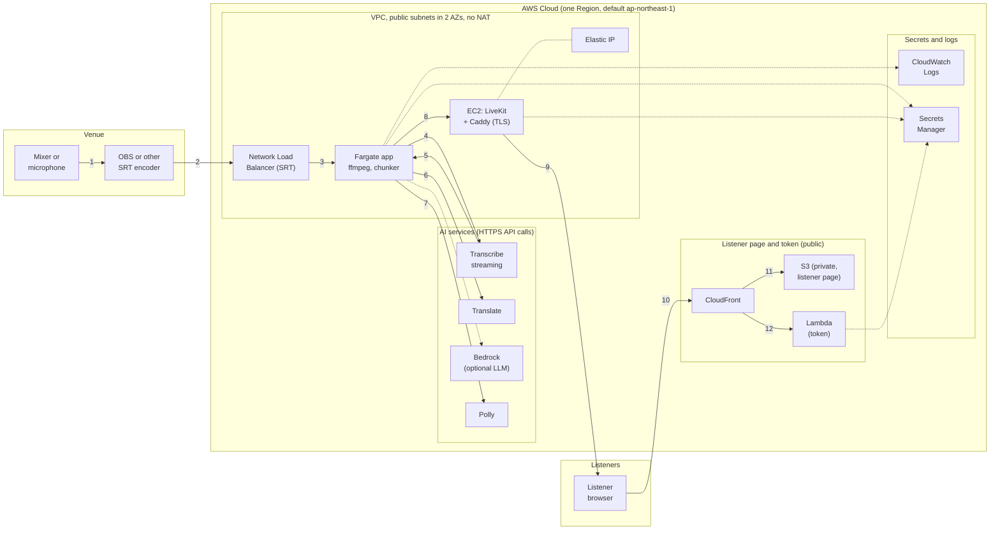

# Architecture


The picture is generated from [`architecture.model.json`](architecture.model.json). The tiles are simplified
drawings, not the official AWS Architecture Icons. The editable file [`architecture.drawio`](architecture.drawio)
uses draw.io's built-in AWS shapes.

## Components

| Component | AWS service or software | What it does | Defined in |
|---|---|---|---|
| Venue encoder | OBS or any SRT encoder | Sends the venue audio as SRT with Opus. | outside the stack |
| SRT entry | Network Load Balancer (UDP 9000) with static Elastic IPs, security groups | Accepts SRT from the venue IP only. | `cdk/lib/simul-translation-stack.ts` |
| App | ECS on Fargate (1 task, ARM64) | Decodes audio, calls the AI services, publishes audio to LiveKit. | `app/src/`, `cdk/lib/` |
| Speech to text | Amazon Transcribe streaming | Text with partial results and per-result language. | `app/src/pipeline.ts` |
| Translation | Amazon Translate, or Amazon Bedrock (optional) | English to Japanese per chunk. | `app/src/translate-engine.ts`, `app/src/bedrock-llm.ts` |
| Text to speech | Amazon Polly | Japanese speech. Readings for product names. | `app/src/chunk-player.ts`, `app/src/polly-readings.ts` |
| Media server | LiveKit (container) and Caddy (TLS) on one EC2 instance with an Elastic IP | Delivers the audio to browsers over WebRTC. | `cdk/lib/livekit-user-data.ts` |
| Listener page | CloudFront, private S3 bucket | Static page with the LiveKit client. Plays the audio and shows the captions. | `app/web/` |
| Token endpoint | Lambda function URL behind CloudFront (`/token`) | Issues subscribe-only LiveKit tokens. | `cdk/lambda/token/` |
| Secrets | Secrets Manager | LiveKit API key and secret, SRT passphrase. | stack |
| Logs | CloudWatch Logs | `/simul-translation/app`, `/livekit`, `/token`. | stack |

## Data flow

The numbers match the diagram.

<!-- BEGIN STEPS (generated by scripts/render-architecture.mjs, do not edit) -->
| Step | What happens |
|---|---|
| 1 | Audio line out from the mixer goes into OBS (or any SRT encoder). |
| 2 | OBS sends SRT with Opus audio over the internet to the load balancer (UDP, venue IP only). |
| 3 | The load balancer passes it to the Fargate app. ffmpeg decodes it to 16 kHz PCM. |
| 4 | The app streams the audio to Transcribe streaming, with language identification. |
| 5 | Transcribe returns text. The app drops non-English results and cuts chunks. |
| 6 | Translate (default) or a Bedrock model (optional, dashed) translates each chunk. |
| 7 | Polly speaks the Japanese text, with readings for product names. |
| 8 | The app publishes the audio to LiveKit over WebRTC (Opus), and the caption text as data packets. |
| 9 | The listener's browser plays the audio and shows the captions from LiveKit (subscribe only). |
| 10 | The browser loads the page from CloudFront and asks for a token. |
| 11 | CloudFront serves the page from a private S3 bucket. |
| 12 | CloudFront calls the token Lambda, which returns a subscribe-only token. |
<!-- END STEPS -->

Inside the app (steps 3 to 8), each stage is a small module:

1. `srt-source.ts` runs ffmpeg as the SRT listener and writes 16 kHz mono PCM. The first PCM arrives within
   about a second (`SRT_ANALYZE_MS`).
2. `pipeline.ts` sends 100 ms frames to Transcribe streaming with language identification between `en-US` and
   `ja-JP`.
3. `language-gate.ts` forwards only results identified as the source language. Japanese speech (a moderator, a
   question from the room) is dropped.
4. `segmenter.ts` turns partial results into chunks of a few words (see "Design choices").
5. `translate-engine.ts` translates each chunk. With the LLM engine a failed or slow call falls back to Translate.
6. `chunk-player.ts` asks Polly for speech, picks a speed level, and writes the audio to LiveKit in order. When the
   audio of a chunk starts, it sends the Japanese caption (`caption-publisher.ts`, see "Captions").
7. If the listener falls too far behind, chunks are dropped (`MAX_BACKLOG_MS`) instead of piling up.

## Latency budget

Measured for the start of a sentence with the `talk` profile (fast timing, LLM engine). `e2eFirstWordMs` is
the time from the speaker saying the first word of a chunk to the listener hearing its first translated word.

| Stage | Typical time | Note |
|---|---|---|
| Speaker says the chunk | about 3.2 s | The chunk must be spoken before it can be cut. Shorter chunks lower this. |
| Transcribe waits for stable words | about 2.0 s | Partial-result stabilization (`PARTIAL_STABILITY=high`). |
| Translation (LLM) | about 0.5 s | Amazon Translate is about 0.6 s per chunk faster in this setup but scored lower. |
| Polly | about 0.16 s | One request per chunk. |
| Queue and network | about 0.2 s | Waiting for the previous chunk to finish playing, then WebRTC. |
| **Total, first word** | **about 6 s** | Typical `e2eFirstWordMs` with the `talk` profile. |

The numbers come from the project's own test runs. They depend on the speaker's pace and the venue network.
`./e2e/e2e.sh` measures them for your material, see [e2e-testing.md](e2e-testing.md).

## Design choices

**LiveKit, not Amazon IVS.** IVS Real-Time accepts WHIP publishing, but it requires an H.264 video track, even
for audio only. LiveKit publishes audio-only from a server SDK and plays it in the browser. It is open source
(Apache-2.0) and runs on one EC2 instance. The Chime SDK has no clean path to publish audio from a headless server.

**OBS and SRT for ingest.** Event teams already know OBS. SRT survives packet loss on venue networks and
supports a passphrase. The Network Load Balancer gives static IPs, so the venue can allow-list them.

**Language filter.** Rooms with a moderator or questions in Japanese would otherwise be transcribed as English-looking
words and translated into nonsense. Transcribe identifies the language of every result and the app drops results that
are not the source language. Short low-confidence English fragments inside Japanese speech are dropped too.
`LANGUAGE_FILTER=off` restores the old behavior.

**Chunking with merge and dangling rules.** The segmenter cuts at sentence ends, at clauses once a chunk has
enough words, and on pauses. Two rules keep chunks translatable:

- *Merge:* a very short sentence ("OK.", "I see.") is held and joined with the next one. Complete sentences are never held.
- *Dangling:* a chunk that would end on a preposition, article or "that" waits a short time for the next words.

Both rules have a time limit, so they cannot stall the speech.

**Speed levels.** Japanese speech is usually slower than English. When the backlog grows, Polly speaks faster, in
graded levels (100, 110, 120, 130, 145 percent by default) with a hold time and hysteresis. Small steady changes
sound calmer than large jumps. In listening tests the delay felt smaller than the numbers suggest, because the speech rate stayed steady.

**Readings with SSML `<sub>`.** Polly mispronounces many product names. The app wraps known terms in
`<sub alias="reading">Term</sub>`. The text shown in logs and any display stays the original term. Only the sound
changes. See [dictionaries.md](dictionaries.md).

## Captions

The listener page shows captions below the **Listen** button after the listener presses it. Before that the page is
the page without captions: it does not connect to LiveKit. There is no toggle and no other control. Two lines roll:

- **Japanese** (primary, larger): shown when the chunk's Japanese audio starts.
- **English source** (secondary, smaller, `#555` on white, contrast 7.5:1): shown as soon as the words are recognised,
  several seconds before the Japanese. `?source=off` in the page URL hides it. It is a URL option, not a setting.

The deploy setting `captions` (`on` by default, env `CAPTIONS`, see [configuration.md](configuration.md)) turns both
lines off. With `off` the app sends no data packets and `config.json` has `"captions": false`, so the page behaves as
before captions existed.

### Transport

The app's publisher participant (`publisher-app`) sends JSON (UTF-8) as **reliable LiveKit data packets** on topic
`captions` (`@livekit/rtc-node` `publishData`). Browsers receive them with `RoomEvent.DataReceived` in the room they
already joined for the audio. The page ignores other topics and any packet whose sender is not `publisher-app`.
Listener tokens stay subscribe-only (`canPublishData=false`); receiving data needs only `canSubscribe`.

### Event contract (schema v1)

One versioned contract with two event types. The builders are in `app/src/caption-event.ts`, the parser is in
`app/web/captions.js`.

```json
{"v":1,"type":"caption","id":"1-42","seq":57,"session":1,"channel":"ja","lang":"ja","text":"…","sourceLang":"en","sourceText":"…","speaker":null,"final":true,"startAt":1760000000000,"durationMs":3200}
{"v":1,"type":"source","op":"append","id":"1-17","seq":58,"session":1,"resultId":"1a2b3c4d","channel":"en","lang":"en","text":"so today we are","stable":true,"boundary":false,"speaker":null,"audioEnd":12.34}
{"v":1,"type":"source","op":"retract","seq":59,"session":1,"resultId":"1a2b3c4d","channel":"en","lang":"en"}
```

| Field | Meaning |
|---|---|
| `v` | Major schema version. Consumers ignore events with a `v` they do not know. |
| `type` | `caption` (Japanese chunk) or `source` (English words). Unknown types are ignored. |
| `seq` | Increases across both types within one app run. |
| `id`, `session` | `caption`: `<session>-<chunk number>` (as `[chunk N]` in the logs). `source`: `<session>-<batch number>`. |
| `channel`, `lang` | `ja` / `en` today. Reserved for the two-channel bilingual mode (more `channel` values). |
| `speaker` | `null` today. Reserved for speaker detection. |
| `text` | `caption`: the Japanese exactly as sent to Polly, before the SSML `<sub>` readings are applied, so product names are never replaced by readings. `source`: the words of this batch, fillers removed. At most 600 characters. |
| `sourceText`, `sourceLang` | `caption` only: the English that was translated (fillers removed, corrections applied). The page does not show it (the English line comes from `source` events). |
| `final` | Always `true`. `false` is reserved for later partial updates of the same `id`; the page ignores it today. |
| `startAt`, `durationMs` | `caption` only: server time (ms) when the audio starts, and the audio length. Diagnostic. |
| `op`, `resultId`, `boundary`, `stable`, `audioEnd` | `source` only: `append` or `retract`; the Transcribe result (first 8 characters, as in the logs); `boundary` = the batch ends a sentence; `stable` is always `true`; `audioEnd` = stream seconds of the last word (diagnostic). |

Changes are additive only: new fields, new `type` or `channel` values. Consumers must ignore unknown fields. A change
that breaks this needs `v: 2`.

### Caption timing

**Japanese.** In `chunk-player.ts` the app knows when a chunk becomes audible: the time of the push plus the audio
still queued in the LiveKit `AudioSource` (up to about 1 s). It arms a timer for that moment just before `pushPcm`,
so the caption packet leaves when the first sample of the chunk leaves the app. If the push fails, the timer is
cleared. Chunks that are dropped, skipped or failed get no caption. All listeners get the same packet, so no clock
sync is needed in the browser.

The audio still passes the browser's jitter buffer and decoder, so the page holds each Japanese caption back by
`CAPTION_OFFSET_MS` (230 ms, in `app/web/subscriber.js`). The value comes from a local measurement (local LiveKit
1.13.7, headless Chrome, the `talk-single` sample, audio onsets found with Web Audio): with 0 ms the captions came
165-271 ms before the voice (median 227); with 230 ms they are within -50 to +55 ms of it (median -9, 19 chunks with
a clear onset). Over a real network both the audio and the data take the same path to the LiveKit host, so the
difference stays mostly the jitter buffer. Measure again with `./e2e/e2e.sh` and a phone if the venue network is very
different.

**English.** The English line comes from `Segmenter.commit()` (`segmenter.ts`), the one place where each word of a
Transcribe result is moved into the chunk buffer, exactly once. Words reach it only after the language gate forwards
them (tagged as English, past the settle rule, stable), so the line shows the same words that are translated: no
unstable partials, no duplicates, nothing the segmenter does not commit. A segmenter tap (`SegmenterTap`) receives each
batch. Errors in the tap are caught, so a caption bug cannot change the chunks. The publisher combines batches of one
result for up to 250 ms (a sentence end flushes at once), so the English stream is at most about 4 packets per second.
Measured on the same run: a batch leaves the app a median 1.4 s (p90 1.8 s) after its last word was spoken, while the
Japanese voice of that text starts a median 7.3 s after the last English word with the Amazon Translate engine
(the sample is dense, so the queue grows).

**Retraction.** Transcribe can tag a result as Japanese only in its final, after the gate already forwarded it (late
flip, `late=` in the `[langfilter]` line). The app then sends `op: "retract"` for that `resultId` and the page removes
those words from the English line. Such words can be visible for a few seconds before they disappear. In the local
run there were no late flips (`late=0`, `retracted=0`).

**Fillers.** Single-word fillers (`um`, `uh`, the `fillers` words) are not shown, as they are not translated.
Multi-word filler phrases (`you know`, `I mean`) are removed only from whole chunks before translation, so they can
still appear in the early English line.

### Page behaviour

`app/web/captions.js` is a small pure module (no DOM access, unit-tested in `app/test/captions-assembler.test.ts`):

- Japanese: chunks of one sentence merge into one line until `。？！`, 60 characters, or 6 s without a new chunk.
  At most 3 lines. A line fades out 12 s after its last update.
- English: batches join into lines that end at `.?!`, 90 characters, or 4 s of silence. At most 3 lines,
  10 s before fading. A retract removes that result's words.
- Text goes into the page with `textContent` only. A test fails if the page code contains `innerHTML` or similar.
- Late joiners (and reconnects) see captions from the next words on. There is no history.

Layout: once the first caption arrives, the page is exactly one viewport tall and does not scroll. Below the button
are two areas with a fixed height (Japanese 3 lines, English 2 lines; on screens lower than 500 px 2 and 1 lines).
New text is at the bottom, older text is cut off at the top with a soft fade, so long English never pushes the
Japanese off screen. On screens lower than 700 px the "If you hear nothing" hint is hidden while captions run. The
button does not move. Font sizes scale with `clamp()`, so the same page works on a phone and on a projected screen.
The fade is turned off for `prefers-reduced-motion`. The Japanese area is `aria-live="polite"` for screen readers. The
English area is not announced, as it changes several times a second.

## Mermaid version

GitHub renders this block. It is generated from the same model as the image.

<!-- BEGIN MERMAID (generated by scripts/render-architecture.mjs, do not edit) -->

<!-- END MERMAID -->

## Edit and re-render

The diagram is code. Edit `docs/architecture.model.json` (nodes, groups, edges, step texts), then run:

```bash
node scripts/render-architecture.mjs          # rewrites architecture.svg, architecture.drawio and the blocks in this file
node scripts/render-architecture.mjs --check  # exits 1 if a generated file is out of date (CI runs this)
node --test scripts/render-architecture.test.mjs   # model consistency and up-to-date checks
```

If you edit `architecture.drawio` in draw.io and export an SVG yourself, draw.io writes the host name and a
user-agent string into the file. Run `scripts/scrub-drawio.sh docs/architecture.svg docs/architecture.drawio`
before you commit. `scripts/check-publishable.mjs` fails if that metadata is still there. Changes made in draw.io
are overwritten the next time the renderer runs, so make lasting changes in the model.
